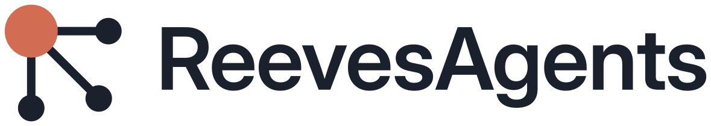
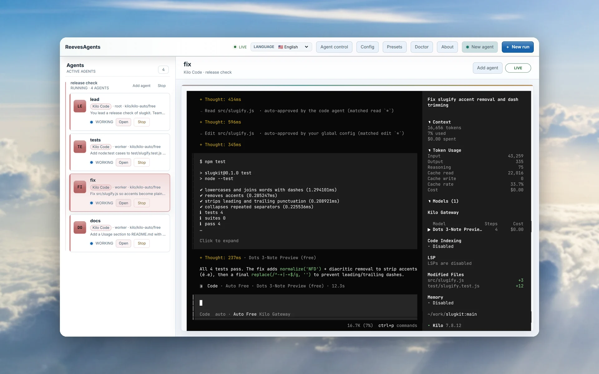
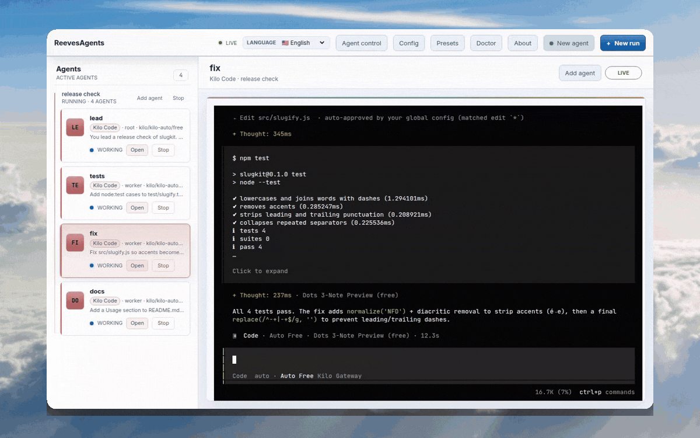
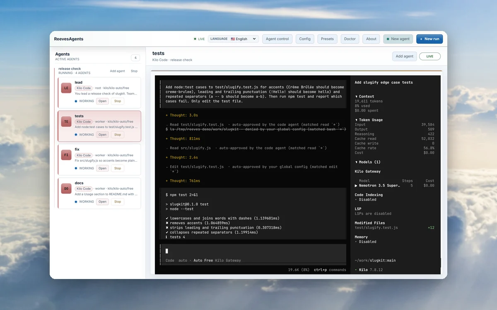
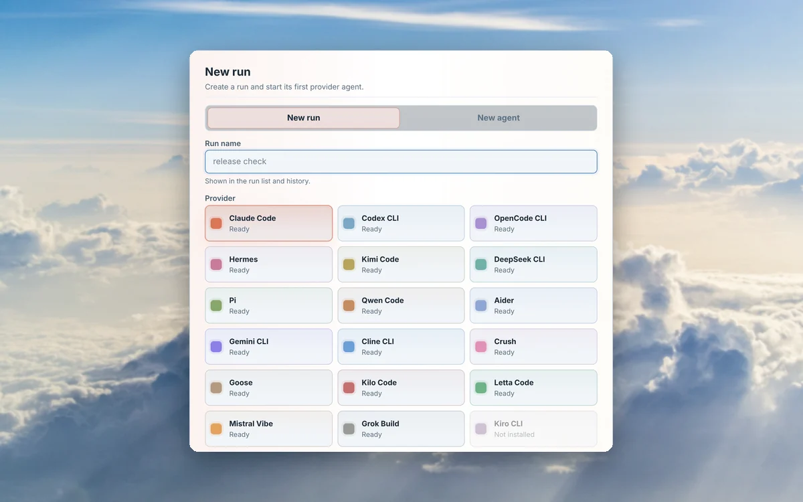
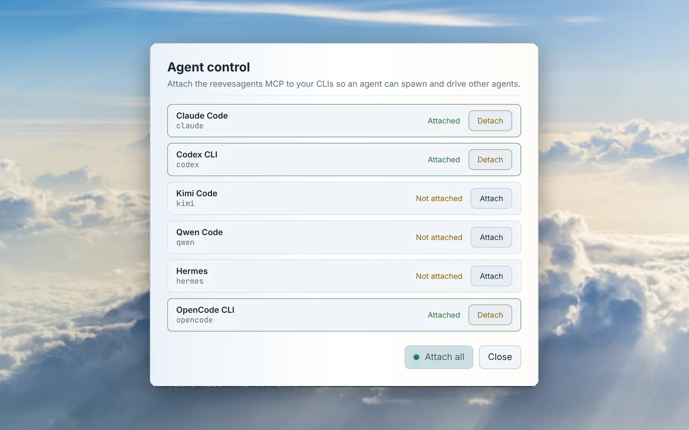
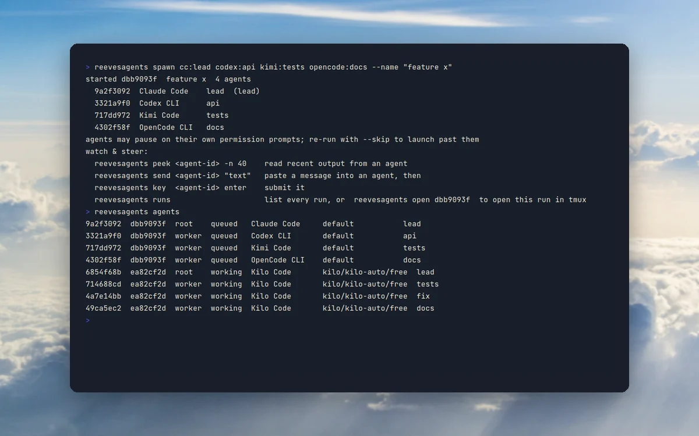

<p align="center">
  <picture>
    <source media="(prefers-color-scheme: dark)" srcset="https://raw.githubusercontent.com/mertkayacs/reevesagents/master/docs/brand/svg/reevesagents-logo-on-dark.svg">
    
  </picture>
</p>

<h1 align="center">Spawn the team. Steer every agent.</h1>

<p align="center">
  Open-source workspace that runs AI coding CLIs side by side on your machine.<br>
  <b>25 CLIs, each in its own tmux window. One of them can drive the rest over MCP.</b>
</p>

<p align="center">
  <a href="https://www.npmjs.com/package/reevesagents"></a>
  <a href="LICENSE"></a>
  
  
  <a href="https://github.com/mertkayacs/reevesagents"></a>
</p>

<p align="center">
  <a href="#quick-start"></a>
  <a href="https://reevesagents.mertkayacs.com/demo/?utm_source=github&utm_medium=readme&utm_campaign=reevesagents-repo&utm_content=demo-badge"></a>
  <a href="https://reevesagents.mertkayacs.com/docs/?utm_source=github&utm_medium=readme&utm_campaign=reevesagents-repo&utm_content=docs-badge"></a>
  <a href="https://reevesagents.mertkayacs.com/?utm_source=github&utm_medium=readme&utm_campaign=reevesagents-repo&utm_content=website-badge"></a>
  <a href="https://www.npmjs.com/package/reevesagents"></a>
  <a href="https://registry.modelcontextprotocol.io/?q=io.github.mertkayacs/reevesagents"></a>
</p>

<p align="center">
  <picture>
    <source media="(prefers-color-scheme: dark)" srcset="https://raw.githubusercontent.com/mertkayacs/reevesagents/master/docs/assets/readme/hero-dark.webp">
    
  </picture>
</p>

ReevesAgents is a free, open-source workspace for AI coding agents. It runs Claude Code, Codex, Kimi, OpenCode, Gemini CLI and 20 other coding CLIs side by side, each in its own tmux window, and gives you a terminal UI, a browser UI and a scriptable CLI over the same runs. Attach its MCP server to one CLI and that agent can spawn, read, steer and stop the others. Every CLI keeps its own login, and ReevesAgents keeps its state in a few JSON files under `~/.reeves`.

---

## Why ReevesAgents

You already use these CLIs, and you are already signed in to them. ReevesAgents runs them as a team on your machine and leaves every login where it was.

|  |  |
|---|---|
|  **25 CLIs, one workspace** | Claude Code, Codex, Kimi, OpenCode, Hermes, Gemini CLI and [19 more](#supported-clis) start from one command. Each runs as the real CLI in its own tmux window, so agents keep running after you close the UI. |
|  **One agent drives the rest** | `reevesagents attach cc` gives Claude Code the MCP tools to spawn, read, steer and stop other agents. Codex, Kimi Code, Qwen Code, Hermes and OpenCode can host it too, and it stays off until you attach it ([details](docs/mcp.md)). |
|  **Your logins stay put** | Each CLI signs in the way it always does. ReevesAgents stores no API keys, adds no proxy, and redacts token-like text in tasks, notes and approvals before it writes state. |
|  **Four ways in** | A terminal UI, a Web UI with a live pane per agent, a CLI with `--json` output for scripts, and the MCP. All four read and write the same runs. |
|  **Plain local state** | A few JSON files under `~/.reeves`, with no database and no Docker. The Web UI answers on 127.0.0.1 only and rejects foreign Host and Origin headers ([guards](src/surfaces/webui/guards.ts)). |
|  **macOS, Linux, WSL, Windows** | tmux 3.0 or newer on macOS, Linux and WSL. Native Windows 10 1809 or later runs on the built-in winmux multiplexer over ConPTY, without WSL ([2.1.0](CHANGELOG.md)). |

## A quick tour

<p align="center">
  
</p>

<table>
  <tr>
    <td width="50%" valign="top">
      <picture>
        <source media="(prefers-color-scheme: dark)" srcset="https://raw.githubusercontent.com/mertkayacs/reevesagents/master/docs/assets/readme/live-panes-dark.webp">
        
      </picture>
      <h3>Watch every agent live</h3>
      Pick an agent to open its live terminal. Here the tests agent has added three cases and npm test reports two failures.
    </td>
    <td width="50%" valign="top">
      <picture>
        <source media="(prefers-color-scheme: dark)" srcset="https://raw.githubusercontent.com/mertkayacs/reevesagents/master/docs/assets/readme/new-run-dark.webp">
        
      </picture>
      <h3>Start a run from the browser</h3>
      Choose one of the 25 CLIs, a model and a permission mode. CLIs that are not installed are marked.
    </td>
  </tr>
  <tr>
    <td width="50%" valign="top">
      <picture>
        <source media="(prefers-color-scheme: dark)" srcset="https://raw.githubusercontent.com/mertkayacs/reevesagents/master/docs/assets/readme/agent-control-dark.webp">
        
      </picture>
      <h3>Let one agent drive the rest</h3>
      Attach the MCP to Claude Code, Codex, Kimi Code, Qwen Code, Hermes or OpenCode, then restart that CLI to load the tools.
    </td>
    <td width="50%" valign="top">
      <picture>
        <source media="(prefers-color-scheme: dark)" srcset="https://raw.githubusercontent.com/mertkayacs/reevesagents/master/docs/assets/readme/cli-dark.webp">
        
      </picture>
      <h3>Script it from the terminal</h3>
      One spawn line starts a mixed team and prints the commands to watch and steer it.
    </td>
  </tr>
</table>

<p align="center"><sub>The Web UI screenshots show a demo run of four Kilo Code agents on a sample repository. Any of the 25 CLIs works the same way.</sub></p>

## Features

**Run a team**

- `reevesagents spawn provider[:nickname[:model]]` starts a run. The first agent leads and the rest join as workers, and `reevesagents add` grows the latest run.
- Per agent you choose the model, the permission mode (ask first, or skip with each CLI's own bypass flag), reasoning effort for Claude Code and Codex, and extra launch flags.
- Presets save a live run and start it again later. Ended runs move to history, and `reap` ends zombie agents and orphan tmux sessions.

**Watch and steer**

- `peek` reads recent output, `send` pastes text and `key <id> enter` submits it, `interrupt` sends Ctrl-C and `open` jumps to the agent's tmux window. `stop` and `kill` need `--yes`.
- The Web UI shows every run, a live terminal for the selected agent, approvals, presets and history, in a light or dark theme and ten languages.
- A CLI with the MCP attached can ask for approval before a risky step, and you approve or deny it from the CLI or the Web UI.

**Develop, review, fix**

- `reevesagents flow start` attaches a flow to an existing run: a developer agent, a reviewer agent and the repository. Each `flow tick` moves it one step: the developer gets the next spec, the reviewer checks the commit, and the item is closed or sent back for a fix within the round budgets.
- Specs wait in a queue (`flow add-spec`) or come from a plan imported from a document in the repository (`flow plan`). `status`, `notes`, `logs` and `incidents` show where each flow stands, what the reviewer found, the journal, and questions or failures that need attention. The TUI, the Web UI and the MCP tools show the same flows, and the MCP server runs a step only when asked.

**Agent Control (MCP)**

- `reevesagents attach` connects every installed host CLI, or one by its id: `cc`, `codex`, `kimi`, `qwen`, `hermes` or `opencode`. `hosts` shows the state and `detach <id>` removes it.
- The host gets tools to spawn agents, read their output, send text and keys, interrupt, stop, and handle approvals and presets. Workers get none of them unless you attach their CLI too.
- A Claude Code plugin ships in this repository, and the server is listed in the official MCP Registry as io.github.mertkayacs/reevesagents.

**Local by design**

- State is plain JSON under `~/.reeves`, and `REEVES_REGISTRY` and `REEVES_CONFIG` move it elsewhere.
- Provider credentials are never stored and model traffic goes straight from each CLI to its provider. Known token patterns are redacted before state is written.
- The Web UI binds to 127.0.0.1, checks the Host header on every request and checks the Origin header on every request that changes state.

**Helper tools**

- `reevesagents tools` lists Perplexity CLI, Google Colab CLI, Hugging Face CLI and Ollama with a purpose, an example command and their install and sign-in state. Agents call them from their own shell.

## Quick start

Install with pnpm, check the machine, then open the terminal UI:

```sh
pnpm add -g reevesagents
reevesagents doctor
reevesagents
```

npm, Homebrew and a one-off check work too:

```sh
npm install -g reevesagents
brew install mertkayacs/reevesagents/reevesagents
npx reevesagents doctor
```

Start a team from the command line:

```sh
reevesagents spawn claude-code:lead codex:tests hermes:research \
  --name "release check" \
  --prompt "Review the release path, test coverage, and docs."
```

Open the Web UI, which listens on 127.0.0.1 only:

```sh
reevesagents web
```

Let Claude Code drive the others, then restart it so it loads the MCP tools:

```sh
reevesagents attach cc
reevesagents hosts
```

In Claude Code you can install the connection and its operating instructions as a plugin instead:

```sh
claude plugin marketplace add mertkayacs/reevesagents
claude plugin install reevesagents@reevesagents
```

### Requirements

- Node.js 22.12 or newer.
- tmux 3.0 or newer on macOS, Linux and WSL. Native Windows 10 1809 or later uses the built-in winmux multiplexer instead.
- At least one supported coding CLI, installed and signed in. `reevesagents doctor` checks Node, tmux and which CLIs it can launch.
- The Web UI uses the optional `ws` and `@lydell/node-pty` modules, which npm installs by default.

## Supported CLIs

Use the id in a spawn spec such as `codex:tests`. Aliases like `claude` work there too, while `attach` and `detach` take the id.

| CLI | id | MCP host |
|---|---|---|
| Claude Code | `cc` | yes |
| Codex CLI | `codex` | yes |
| OpenCode CLI | `opencode` | yes |
| Hermes | `hermes` | yes |
| Kimi Code | `kimi` | yes |
| DeepSeek CLI | `deepseek` |  |
| Pi | `pi` |  |
| Qwen Code | `qwen` | yes |
| Aider | `aider` |  |
| Gemini CLI | `gemini` |  |
| Cline CLI | `cline` |  |
| Crush | `crush` |  |
| Goose | `goose` |  |
| Kilo Code | `kilo` |  |
| Letta Code | `letta` |  |
| Mistral Vibe | `vibe` |  |
| Grok Build | `grok` |  |
| Kiro CLI | `kiro` |  |
| Factory Droid | `droid` |  |
| Qoder CLI | `qoder` |  |
| Warp | `warp` |  |
| Junie CLI | `junie` |  |
| GitHub Copilot CLI | `copilot` |  |
| Cursor CLI | `cursor` |  |
| Rovo Dev CLI | `rovo` |  |

<sub>The binary on your PATH matches the id, except `claude` (cc), `kiro-cli` (kiro), `qodercli` (qoder), `cursor-agent` (cursor) and `acli` (rovo). `reevesagents providers` shows which of them it finds, with their aliases and suggested models.</sub>

## FAQ

<details>
<summary><b>Does ReevesAgents store my API keys?</b></summary>

No. Each CLI keeps its own login and keys, the same as when you run it by hand. ReevesAgents keeps run records under `~/.reeves` and redacts text that looks like a token before writing it.
</details>

<details>
<summary><b>Does my code leave my machine?</b></summary>

Each coding CLI sends your code to its own model provider, as it always does, and ReevesAgents adds nothing in between. The Web UI answers only on 127.0.0.1. To use it from another machine, forward the port over SSH with `ssh -L 8080:127.0.0.1:8080 user@host`.
</details>

<details>
<summary><b>Do I have to let one agent control the others?</b></summary>

No. Agents can work side by side with nobody in charge. Agent Control is an MCP server you attach to one CLI with `reevesagents attach cc` (or another id), and `reevesagents detach cc` removes it.
</details>

<details>
<summary><b>Can Codex drive the team?</b></summary>

Yes. Codex sandboxes MCP calls by default, which blocks tmux launches, so run it with full access when it hosts the MCP, for example `codex --sandbox danger-full-access`, or use a Codex profile that sets `sandbox_mode = "danger-full-access"`.
</details>

<details>
<summary><b>What happens when I close the UI?</b></summary>

The agents keep working. Each one lives in its own tmux window, or a winmux window on native Windows, and `reevesagents open <id>` takes you back to it.
</details>

<details>
<summary><b>Does it run on Windows?</b></summary>

Yes. Since 2.1.0 it runs natively on Windows 10 1809 and later through the built-in winmux multiplexer, and it also runs in WSL.
</details>

<details>
<summary><b>Can I script it?</b></summary>

Yes. `spawn`, `runs`, `agents`, `providers` and `doctor` accept `--json`, and `REEVES_REGISTRY` and `REEVES_CONFIG` keep a scripted run away from your own `~/.reeves`.
</details>

<details>
<summary><b>What does it cost?</b></summary>

ReevesAgents is free under Apache-2.0. Your providers bill you as usual, and ReevesAgents adds nothing on top.
</details>

## Documentation

- [User guide](docs/GUIDE.md), also in nine other languages
- [Agent Control MCP](docs/mcp.md): attaching, the tool list and the safety model
- [AGENTS.md](AGENTS.md): how an AI agent drives ReevesAgents
- [Online docs](https://reevesagents.mertkayacs.com/docs/?utm_source=github&utm_medium=readme&utm_campaign=reevesagents-repo&utm_content=docs-link): every command, configuration key and provider
- [FAQ](https://reevesagents.mertkayacs.com/faq/?utm_source=github&utm_medium=readme&utm_campaign=reevesagents-repo&utm_content=faq-link)
- [Changelog](CHANGELOG.md)
- README in [Deutsch](docs/i18n/README.de.md), [Français](docs/i18n/README.fr.md), [Español](docs/i18n/README.es.md), [Português](docs/i18n/README.pt.md), [Italiano](docs/i18n/README.it.md), [Türkçe](docs/i18n/README.tr.md), [Русский](docs/i18n/README.ru.md), [简体中文](docs/i18n/README.zh-Hans.md) and [العربية](docs/i18n/README.ar.md)

## Build from source

```sh
git clone https://github.com/mertkayacs/reevesagents.git
cd reevesagents
pnpm install
pnpm build
pnpm link --global
reevesagents doctor
```

## Development

Contributors use pnpm, TypeScript, tsup, Vitest and ESLint from the repository. Run the focused checks before a pull request:

```sh
pnpm typecheck
pnpm lint
pnpm test
pnpm verify
```

`pnpm verify` runs the type check, lint, unit tests, the build, a CLI smoke test against fake provider binaries and a check of the npm package contents. [Testing](docs/testing.md) and [releasing](docs/releasing.md) have the details.

## Contributing and security

Issues and pull requests are welcome. See [CONTRIBUTING.md](.github/CONTRIBUTING.md). Report vulnerabilities privately as described in [SECURITY.md](.github/SECURITY.md).

If ReevesAgents is useful to you, a ⭐ helps other people find it.

## License

[Apache-2.0](LICENSE). ReevesAgents is built by Mert Kaya at Eschatia Labs, an independent, non-profit open-source AI research lab. Photos behind the screenshots are credited in [docs/assets/readme/CREDITS.md](docs/assets/readme/CREDITS.md).

[](https://reevesagents.mertkayacs.com/?utm_source=github&utm_medium=readme&utm_campaign=reevesagents-repo&utm_content=views-badge)
