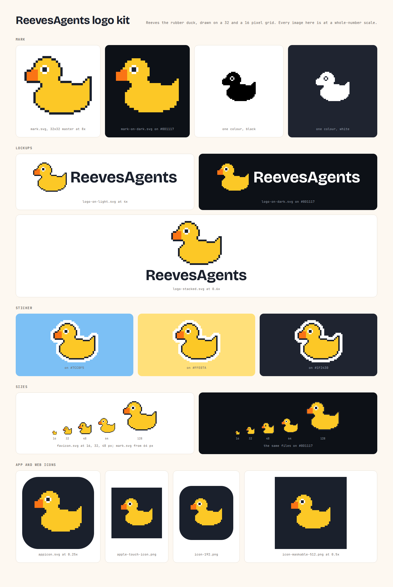

# ReevesAgents logo kit

Reeves, the rubber duck that greets you in the ReevesAgents terminal UI, drawn on the same pixel grid as the terminal
it lives in.

The mark exists as two pixel masters. `favicon/favicon.svg` is the 16x16 drawing with a solid ink eye, made for
browser tabs. `svg/reevesagents-mark.svg` is the 32x32 drawing with the mascot's white eye and pupil, made for 64 px
and up. Everything else in the kit is built from these two grids.



## Files

| File | Use |
|---|---|
| `svg/reevesagents-mark.svg` | Colour mark for light grounds (32x32 grid, square) |
| `svg/reevesagents-mark-on-dark.svg` | Colour mark for dark grounds such as `#0D1117` and `#1F2430` |
| `svg/reevesagents-mark-black.svg`, `-mark-white.svg` | One colour; the eye is a real hole |
| `svg/reevesagents-sticker.svg` | Die-cut sticker, white border two cells wide, for coloured sheets |
| `svg/reevesagents-logo-on-light.svg`, `-logo-on-dark.svg` | Horizontal lockup, height 256 |
| `svg/reevesagents-logo-stacked.svg` | Duck above the name |
| `svg/reevesagents-appicon.svg` | Graphite rounded tile, 1024 |
| `png/` | Exact renders of the above |
| `favicon/` | `favicon.svg`, `favicon.ico` (16, 32, 48), `favicon-32.png`, `apple-touch-icon.png`, `icon-192.png`, `icon-512.png`, `icon-maskable-512.png` |

For a web page:

```html
<link rel="icon" href="/favicon.ico" sizes="32x32">
<link rel="icon" href="/favicon.svg" type="image/svg+xml">
<link rel="apple-touch-icon" href="/apple-touch-icon.png">
```

## The pixel rule

Every cell of the duck must stay one square of one colour. Scale only by whole numbers. A 1.5x scale mixes 1 px and
2 px cells and the duck looks broken. The SVGs carry `shape-rendering="crispEdges"`; when you scale a PNG, add
`image-rendering: pixelated`.

| File | Sizes that stay exact |
|---|---|
| `favicon.svg` | 16, 32, 48 px (any multiple of 16) |
| `mark.svg` and its variants | 64, 96, 128, 256 px (any multiple of 32, from 64) |
| Horizontal lockups | heights of 64, 96, 128 px (any multiple of 32, from 64) |
| Stacked lockup | widths of 180, 240, 300, 360, 600 px (multiples of 60, from 180) |
| Sticker | widths of 68, 102, 136, 170 px (multiples of 34) |
| App icon | 128, 256, 512, 1024 px |

## Colours

| Role | HEX | on `#FFFFFF` | on `#FDF8F1` | on `#0D1117` |
|---|---|---|---|---|
| Sunflower (body) | `#FCC826` | 1.56 | 1.48 | 12.10 |
| Bill | `#FA7415` | 2.77 | 2.62 | 6.83 |
| Graphite ink (outline, pupil, wordmark) | `#1A202C` | 16.32 | 15.44 | 1.16 |
| White (eye, dark wordmark, sticker border) | `#FFFFFF` | 1.00 | 1.06 | 18.92 |

Contrast ratios are WCAG 2 values, computed from the HEX codes. On light grounds the yellow alone is faint, and the
graphite outline (10.44 against the yellow) holds the shape. On dark grounds the outline would vanish (1.16), so the
on-dark files drop it and the yellow carries the shape at 12.10.

## Clear space

Keep at least four of the duck's own cells free on every side: 16 px around a 128 px mark, 8 px around a lockup shown
64 px tall.

## Minimum sizes

- Favicon: 16 px.
- Mark: 64 px. Below that, use `favicon.svg`.
- Horizontal lockup: 64 px tall.
- Stacked lockup: 180 px wide.
- Sticker: 68 px wide.

## Typeface

The name is set in **Bricolage Grotesque** (google/fonts, `ofl/bricolagegrotesque`), licensed under the **SIL Open
Font License 1.1** ("Copyright 2022 The Bricolage Grotesque Project Authors"). I used weight 700, optical size 48 and
width 100, with tracking 6 units per 1000 tighter, and levelled the four crossbar edges of the e, which rise by
0.6 to 0.7° in this instance. The lockups contain outlines only, so no font file ships with the kit. The licence text
is in `../fonts/bricolagegrotesque-OFL.txt`.

## Do

- Scale by whole numbers and keep cells square.
- Use `favicon.svg` under 64 px and `mark.svg` from 64 px.
- Put the on-dark files on dark grounds and the sticker on coloured sheets.
- Leave the wordmark exactly as delivered.

## Don't

- Smooth, blur, rotate, skew or stretch the duck.
- Add shadows, glows, gradients or a second outline, or recolour any part, the graphite ink included.
- Place the light-ground mark on a dark ground, where its outline disappears.
- Retype the name, in live text or in another font.
